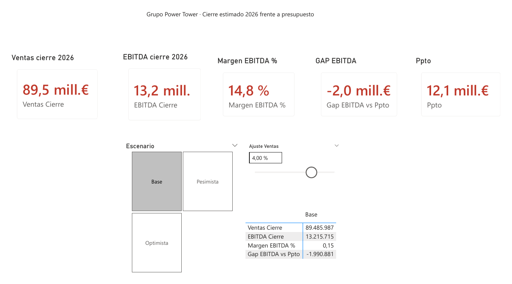
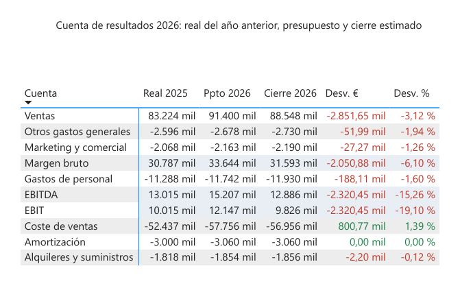
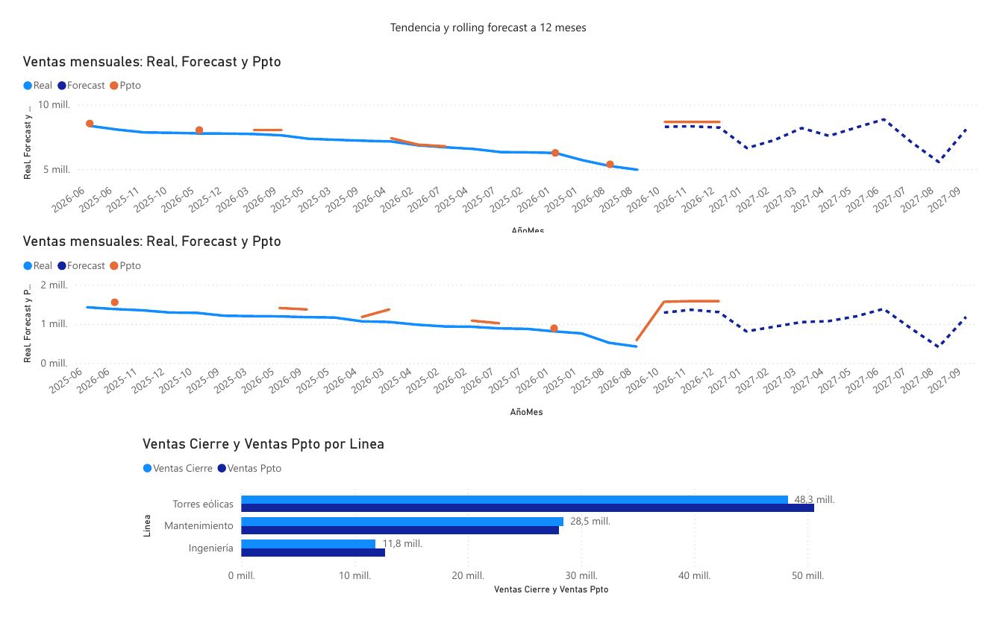

# Rolling forecast y escenarios · Grupo Power Tower

**Informe de FP&A en Power BI que estima el cierre de 2026 en tres escenarios, proyecta los próximos 12 meses y mide la sensibilidad del EBITDA a las ventas.**



## Contexto de negocio
Grupo Power Tower fabrica torres eólicas, mantiene parques y presta servicios de ingeniería. Con el real cerrado a septiembre de 2026, el director financiero necesita saber cómo cerrará el año frente a un presupuesto ambicioso, qué esperar en los próximos 12 meses y cuánto margen de maniobra queda. El informe permite cambiar de escenario (base, optimista o pesimista) y ajustar las ventas con un deslizador para ver el impacto al momento.

## Datos
Datos sintéticos (363 filas), generados con `src/generar_datos.py`:
- `real_ERP.csv`: real mensual por cuenta y línea de negocio (enero de 2025 a septiembre de 2026).
- `presupuesto_2026.xlsx`: presupuesto en formato ancho, con los meses en columnas.
- `maestros.xlsx`: estructura de la cuenta de resultados, líneas de negocio, escenarios y drivers.

**Transformaciones en Power Query:** conversión del periodo de texto a fecha, despivotado del presupuesto (de 12 columnas de meses a filas), tipado explícito de columnas y parámetro `RutaDatos` para que el proyecto sea portable.

## Modelo de datos

Esquema en estrella con dos tablas de hechos (`fReal`, `fPresupuesto`) y tres dimensiones compartidas (`dCalendario`, `dCuenta`, `dLinea`). Los escenarios y sus drivers son **tablas desconectadas**: no filtran datos, solo alimentan el cálculo del forecast.

## Medidas DAX clave
**Forecast:** real del mismo mes del año anterior × factor del escenario. El coste de ventas se mueve con el volumen.
```dax
VAR vFactor =
    SWITCH ( vGrupo,
        "Ventas",          1 + vGVentas,
        "Coste de ventas", ( 1 + vGVentas ) * ( 1 + vG ),
        1 + vG )
VAR vBaseAnoAnterior = CALCULATE ( [Real], SAMEPERIODLASTYEAR ( dCalendario[Fecha] ) )
```
**Rolling:** el horizonte se calcula a partir del último mes con datos reales, así que al cargar un nuevo mes el forecast se desplaza solo.

**Subtotales de la cuenta de resultados:** margen bruto, EBITDA y EBIT se calculan sumando las cuentas de detalle que quedan por encima en la estructura.
```dax
PyG Cierre =
IF ( SELECTEDVALUE ( dCuenta[Tipo] ) = "Subtotal",
     CALCULATE ( [Cierre], REMOVEFILTERS ( dCuenta ),
                 dCuenta[Orden] < SELECTEDVALUE ( dCuenta[Orden] ), dCuenta[Tipo] = "Detalle" ),
     [Cierre] )
```

## Hallazgos
1. **El presupuesto no se cumple en ningún escenario:** EBITDA de cierre de 12,9 M€ en el escenario base frente a 15,2 M€ presupuestados (−2,3 M€, −15 %). Ni el escenario optimista (13,5 M€) cierra la brecha.
2. **Torres eólicas explica el 82 % del desvío de ventas** (−2,35 M€). Mantenimiento es la única línea por encima del presupuesto (+0,37 M€).
3. **El problema es de margen, no de estructura:** el margen bruto cae del 36,8 % presupuestado al 35,7 %. Los gastos de estructura solo se desvían 0,27 M€.
4. **Sensibilidad:** cada 1 % de ventas vale unos 82 k€ de EBITDA en el cierre de 2026 (solo quedan 3 meses), pero unos 303 k€ en el forecast a 12 meses.
5. **El margen EBITDA se erosiona:** del 15,6 % en 2025 al 13,9 % en el forecast a 12 meses, porque el coste de ventas (+8,1 %) crece más que las ventas (+6,0 %).

**Recomendación:** reformular el objetivo de 2026, poner en marcha un plan comercial en Torres eólicas y revisar los precios y las cláusulas de inflación de los contratos nuevos.

## Capturas




## Cómo abrirlo
1. Clona el repositorio y abre `RollingForecast.pbip` con Power BI Desktop.
2. *Transformar datos → Administrar parámetros* → cambia `RutaDatos` por la ruta completa de la carpeta `data\` de este repositorio en tu ordenador (terminada en `\`). Todas las consultas leen de ese parámetro.
3. *Inicio → Actualizar*.

Estructura: `RollingForecast.SemanticModel/` contiene el modelo en formato TMDL (tablas, relaciones y medidas DAX legibles), `RollingForecast.Report/` el informe, `data/` los datos de ejemplo, `src/` el script que los genera y `docs/` la guía paso a paso del proyecto.

## Qué aprendí
- Una columna de tipo *Fecha/hora* no se relaciona con una de tipo *Fecha* aunque se vean iguales: Power BI deja los datos fuera sin dar ningún error.
- Las tablas de supuestos van desconectadas y se leen con `SELECTEDVALUE`.
- Marcar la tabla de fechas es imprescindible para que `SAMEPERIODLASTYEAR` funcione bien entre años.
